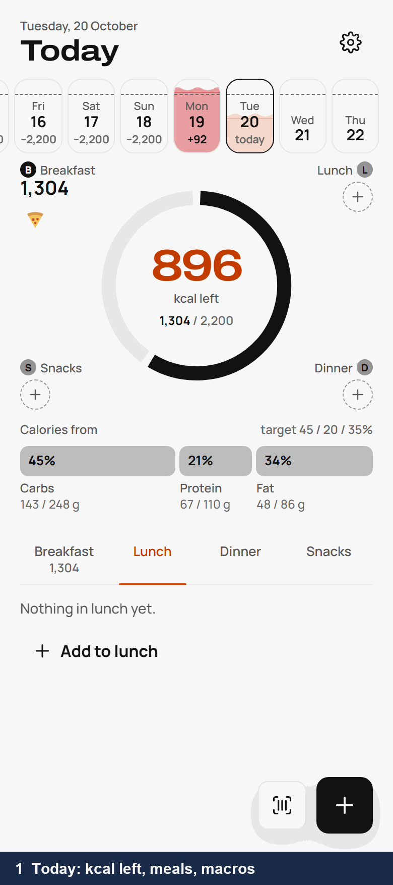
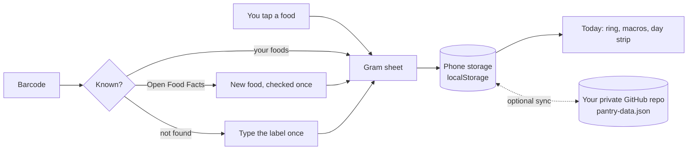

# Pantry

[](LICENSE)


**A calorie and macro log for your phone: pick a food, pick the grams, see what is left today.**

<p align="center">
  
</p>

You had a tuna can for lunch. You open Pantry, tap **+**, and tuna is at the top of your foods with the
185 g you usually have. One more tap and it is logged; the ring shows how many kcal are left today.

- **Fast to log.** Foods you eat often come back with their usual amount, so most meals take two or three taps.
- **Your data stays yours.** The log lives on your phone. No account, no server, no ads, no tracking.
- **You choose where it syncs.** Optionally, it keeps a copy in a private GitHub repo that you own.

Built by Tarık for his own daily use, and shared as is under the MIT licence. Built and tested on Android.

## Quick start

### 1. Use it on your phone

1. Open **<https://estaed.github.io/Pantry/>** in Chrome or Samsung Internet on Android.
2. Add it to the home screen from the browser menu: Chrome's **Add to Home screen** (or **Install app**), Samsung
   Internet's **Add page to**, then **Home screen**. Pantry now opens like an app and works offline.
3. Tap the gear on Today and set your **daily calories**, **macro split** and **salt**. The defaults are 2,200 kcal,
   carbs 45 %, protein 20 %, fat 35 % and 5.8 g of salt.
4. Log: tap **+** (or a meal's corner), choose a food, set the grams, **Add to lunch**.

Five common foods are there to start with. To add a packaged food, tap the barcode button and scan the pack (or
type its number). Pantry looks it up on [Open Food Facts](https://world.openfoodfacts.org/); if it is not found,
you type the values from the label once, and the food is yours from then on.

> Your log is stored in the browser on this phone. Clearing the browser's site data deletes it. Step 2 keeps a copy.

### 2. Optional: keep your data in your own private GitHub repo

Sync copies your log to one JSON file, `pantry-data.json`, in a repo only you can see. Use it to back up your log, or to
use Pantry on two devices.

1. Create a **private** repository on GitHub, for example `pantry-data`. Tick **Add a README file** so it is not empty.
2. Create a fine-grained token at <https://github.com/settings/personal-access-tokens/new>:
   - **Token name**: `Pantry`. **Expiration**: as long as you like. When it ends, Pantry tells you and you paste a new one.
   - **Repository access**: **Only select repositories**, then pick `pantry-data` and nothing else.
   - **Permissions**, **Repository permissions**: **Contents**, set to **Read and write**. GitHub adds **Metadata: Read-only**
     by itself. Do not add anything else.
   - **Generate token** and copy it (it starts with `github_pat_`).
3. In Pantry, open Settings, then **Sync**. Under **Data repo**, type `your-user-name/pantry-data` (pasting the repo's
   github.com address works too). Paste the token under **GitHub token** and tap **Save and sync**.

The token stays on the phone and is never written into the synced file. Pantry pushes about 10 seconds after
your last change and pulls when it opens. If you log on two devices, changes merge entry by entry, and deletions win.

### 3. Run it yourself, or fork it

There is nothing to build. Serve the folder and open it:

```sh
git clone https://github.com/Estaed/Pantry.git
cd Pantry
python -m http.server 8000      # then open http://localhost:8000/
```

The camera needs HTTPS or `localhost`. To host your own copy, fork the repo and turn on **GitHub Pages**
(Settings, Pages, deploy from the `main` branch, root folder); it is served at `https://<you>.github.io/Pantry/`.

## How it works



1. Everything you log is saved on the phone first, so Pantry works with no network.
2. Each entry keeps the nutrients it had when you logged it. Editing a food later never changes past days.
3. Changing a target holds from that day on; past days keep the budget they had.
4. The only network calls are Open Food Facts (when you look up a new barcode) and the GitHub API (only if you set up sync).

<details>
<summary>Files, tests and the optional tools</summary>

**App** (no framework, no bundler, no CDN at runtime)

| Path | What |
|---|---|
| `index.html` | the shell |
| `app/core.js` | the data document, storage, screens and routing |
| `app/today.js`, `log.js`, `entry.js`, `scan.js`, `newfood.js`, `settings.js`, `sync.js`, `drawings.js` | one file per feature, listed in `app/registry.js` |
| `sw.js`, `manifest.json`, `icons/` | offline cache and install |
| `tokens.css`, `fonts/` | the design tokens and the fonts (Archivo, Manrope) |

**Tests.** `tests/acceptance.py` serves the app under `/Pantry/`, drives it in headless Chromium as a phone, with the
GitHub API mocked, then runs every `tests/test_*.py`. It takes about seven minutes.

```sh
pip install playwright==1.62.0
python -m playwright install chromium
python tests/acceptance.py      # every check PASS, exit 0
```

**Optional PC tools** (Python, standard library):

- `tools/import_mynetdiary.py` turns a MyNetDiary history into a Pantry document, so past days come with you if you
  are leaving MyNetDiary. Its input is one JSON file of days in the shape `tests/fixtures/mynetdiary-slice.json`
  shows, read from MyNetDiary's web app while signed in; no downloader is included. Put the result in your data repo
  as `pantry-data.json`, then connect sync, and your phone merges it in.
- `tools/catalogue.py` builds a barcode catalogue from the author's own Coles and Woolworths purchase data captured
  in a browser. It is specific to his setup; the app works without a catalogue.

**Other notes**

- The **Dynamic** theme follows sunrise and sunset in Darwin, where the author lives. Elsewhere, pick **System**,
  **Light** or **Dark**.
- Barcode scanning uses the browser's built-in `BarcodeDetector` (Chrome on Android). Where it is missing,
  type the barcode instead. Not tested on iPhone.
- Nutrition values come from what you or Open Food Facts enter. Pantry is a log, not medical advice.
- `docs/blueprint.md`, `notes.md`, `tasks/` and `reports/` are the author's own planning notes.

</details>

## Credits

Fonts: [Archivo](fonts/OFL-Archivo.txt) and [Manrope](fonts/OFL-manrope.txt), SIL Open Font License.
Icons drawn after [Lucide](https://lucide.dev) (ISC). Product data: [Open Food Facts](https://world.openfoodfacts.org/), ODbL.

## Licence

[MIT](LICENSE)
